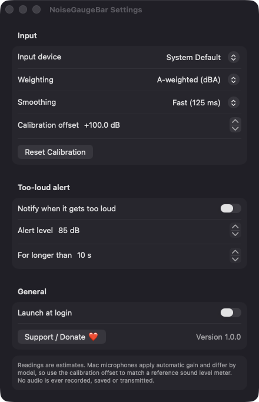

# NoiseGaugeBar

**🌐 Website:** [turhe123.github.io/noise-gauge-bar](https://turhe123.github.io/noise-gauge-bar/)

A menu bar decibel readout of the room around your Mac with a history graph and a too-loud alert.

> 🆓 A free, open-source **Decibel Meter Analyzer alternative** for macOS 14+. Native Swift, no accounts, no subscriptions, MIT licensed.


## Why

NoiseGaugeBar is a free, open-source, 100% native, backend-free alternative to paid utilities in the *System Monitoring* category. It was inspired by apps such as Decibel Meter Analyzer ($4.99 one-time), and it brings a simple version of that idea to the menu bar. It is written in Swift with SwiftUI and AppKit, has no dependencies, and has no server. Audio is analysed in memory and is never recorded, saved or transmitted.

## Features

- **Live menu bar readout:** a tiny level bar plus the current reading in dB, updated about four times a second.
- **Popover with a large value:** it shows a descriptive word (Quiet, Conversation, Busy or Loud) and a colour-coded level bar.
- **5-minute history graph:** a Canvas graph of the last 1200 samples, with grid lines and a dashed line at your alert level.
- **Statistics:** Min, Avg and Max since start, with a Reset button that also clears the graph.
- **A-weighting or unweighted (Z):** switch between dBA and unweighted readings.
- **Fast (125 ms) or Slow (1 s) smoothing:** the same idea as the Fast and Slow settings on a classic sound level meter.
- **Calibration offset:** adjust in 0.5 dB steps to match a reference meter, with a Reset Calibration button.
- **Too-loud alert:** a local notification when the level stays above your threshold (default 85 dB) for longer than a set number of seconds (default 10 s). A 3-minute cooldown stops repeat alerts. The alert is off by default.
- **Input device picker:** choose a specific microphone or use the system default. The meter restarts when devices change.
- **Pause switch:** stops measuring. The meter also pauses while the Mac sleeps and resumes on wake.
- **Launch at login:** uses `SMAppService`.
- **Friendly empty states:** a first-run privacy explanation, guidance with a shortcut to the Privacy pane when microphone access is denied, and a message when the microphone is missing or busy.
- **Menu bar only:** there is no Dock icon.

> Readings are estimates. Mac microphones apply automatic gain and differ by model, so use the calibration offset to match a reference sound level meter.

## Screenshots

<p align="center"></p>

<p align="center"><em>The Settings window, where you pick the input device, A-weighted or unweighted readings, Fast or Slow smoothing, a calibration offset, the too-loud alert threshold and duration, and launch at login.</em></p>

## Install

1. Download `NoiseGaugeBar-macOS.zip` from the [latest release](https://github.com/turhe123/noise-gauge-bar/releases/latest).
2. Unzip it and move `NoiseGaugeBar.app` to `/Applications`.
3. The app is open source and not notarized, so clear the quarantine flag:

   ```bash
   xattr -cr /Applications/NoiseGaugeBar.app
   ```

4. The first time, right-click the app and choose **Open**.

## Build from source

Requires macOS 14+ and Xcode with Swift 5.9 or later.

```bash
brew install xcodegen
xcodegen generate
xcodebuild -project NoiseGaugeBar.xcodeproj -scheme NoiseGaugeBar -configuration Release -derivedDataPath ./build build
```

The app is built to `build/Build/Products/Release/NoiseGaugeBar.app`.

## Permissions

| Permission | Why |
| --- | --- |
| **Microphone** (required) | To measure the ambient sound level. Audio is processed in memory only. macOS shows its orange microphone indicator while the app is measuring. |
| **Notifications** (optional) | Only requested when you turn on the too-loud alert, so the app can tell you when the room is too loud. |
| **Login item** (optional) | Only used if you turn on "Launch at login". |

NoiseGaugeBar does **not** need Accessibility or Screen Recording access, and it makes no network connections.

## Built with AI

NoiseGaugeBar was written by [Claude Code](https://claude.com/claude-code) inside an automated pipeline, from a plain-English spec. No code, binaries or assets from any commercial app were used; it is a clean-room reimplementation of a feature set, not a copy.

What that means in practice:

- The full source is in this repo under the MIT license. Read it before you run it.
- No network calls, no analytics, no third-party dependencies. Only Apple frameworks.
- Ad-hoc signed and not notarized, which is why Gatekeeper warns on first launch.
- It has had less human review than a hand-written app. Bug reports and pull requests are welcome.

## Support ❤️

If you find NoiseGaugeBar useful, you can support its development:

[Support Or (Leo) Davidai ❤️](https://ko-fi.com/leodavidai)

The app also has a "Support / Donate ❤️" button in the popover and in Settings.

## More free Mac apps

NoiseGaugeBar is one of a growing collection of [free, open-source Mac utilities](https://github.com/turhe123/mac-apps) built the same way: native Swift, no accounts, no telemetry. Browse the full gallery at [turhe123.github.io/mac-apps](https://turhe123.github.io/mac-apps/).

Prefer something that runs in the browser? The same pipeline builds [free, private web tools](https://turhe123.github.io/web-tools/): PDF, image, developer, data and audio tools, nothing uploaded.

## License

MIT © Or Davidai Bachar
